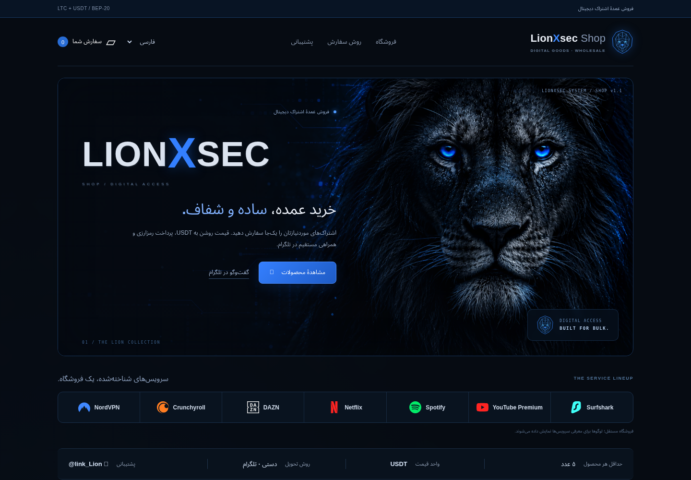

# LionXsec Shop — v1.1

فروشگاه چهارزبانهٔ اشتراک دیجیتال با طراحی شیر چشم‌آبی، پنل مدیریت محصولات و کیف پول‌ها، حداقل سفارش ۵ عدد از هر محصول، و قیمت USDT.

پرداخت با Litecoin یا USDT روی BEP-20 انجام می‌شود. بررسی پرداخت و تحویل از طریق [@link_Lion](https://t.me/link_Lion) کاملاً دستی است.



[دانلود ZIP آماده](https://github.com/alexsalar2029-lgtm/Lionxsec/raw/refs/heads/shop/lionxsec-v1-1/LionXsec-Shop-v1.1-Lion.zip) · [راهنمای کامل فارسی](README_FA.md) · [گزارش آزمون‌ها](VALIDATION.md)

## اجرا

Python 3.11 یا جدیدتر، بدون وابستگی خارجی:

```bash
python server.py init-admin
python server.py
```

در ویندوز فایل `start.bat` را اجرا کنید. نشانی فروشگاه روی همان دستگاه `http://127.0.0.1:8000` و پنل مدیریت `/admin` است.

رمز پیش‌فرض وجود ندارد. محصولات و قیمت‌های اولیه نمونه هستند؛ برای شروع فروش، محصولات واقعی، لوگوها و آدرس‌های عمومی کیف پول را در پنل تنظیم کنید. برای به‌روزرسانی، پوشهٔ `data` نصب خودتان را نگه دارید. این مخزن هیچ رمز، کیف پول واقعی یا پایگاه دادهٔ مشتری ندارد.

## آزمون‌ها

```bash
python -m unittest discover -s tests -v
```

۱۸ آزمون سرور و جریان مرورگر برای چهار زبان، راست‌به‌چپ، انتخاب لوگو، ثبت سفارش، پرداخت LTC و USDT، و تأیید دستی بررسی شده‌اند. سرویس روی دامنهٔ عمومی منتشر نشده است؛ برای میزبانی عملیاتی، دیسک پایدار و HTTPS لازم است.
